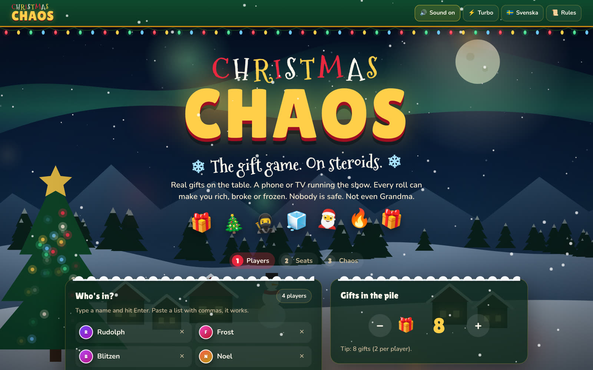
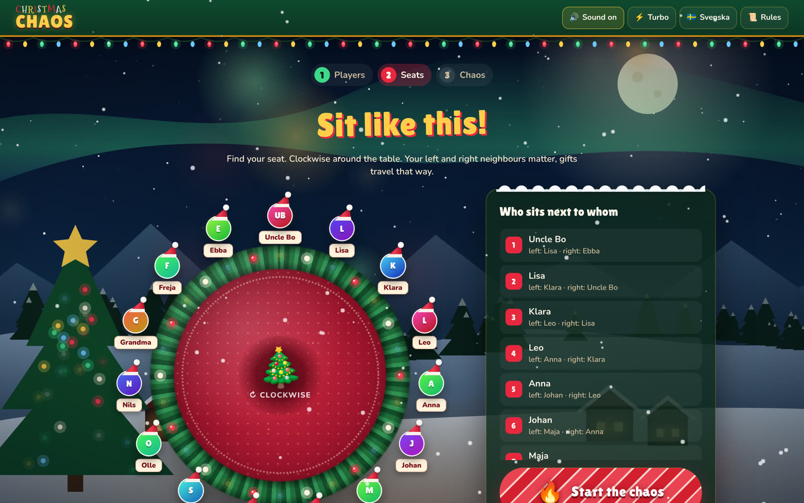
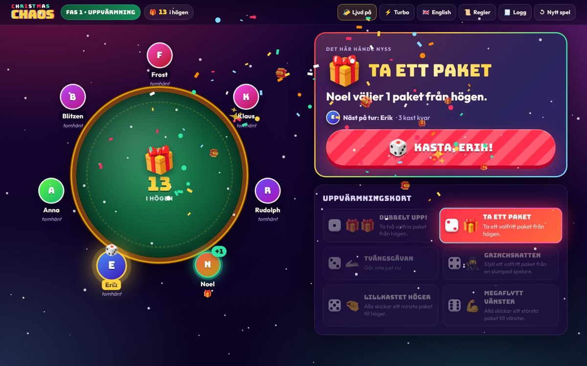
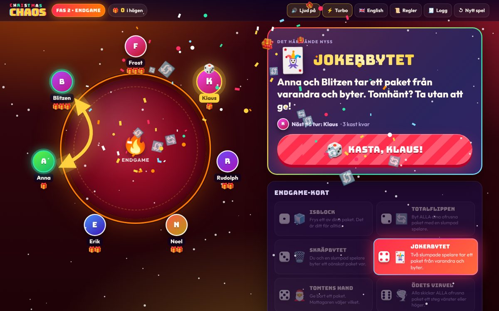

<div align="center">

# 🎁 CHRISTMAS CHAOS 🎄

### The gift game. On steroids.

**Real gifts on the table. One screen running the show. Every roll can make you rich, broke or frozen.<br/>Nobody is safe. Not even Grandma.**

[**▶ Play it now**](https://christmas-chaos-gift-exchange.vercel.app/) · No sign-up · No backend · Works on phone, laptop and TV



</div>

---

## What is this?

You know the classic dice gift game. Pile of presents in the middle, everybody rolls, people grab, steal and swap until the timer runs out and someone ends up crying over a scented candle.

**Christmas Chaos is that game with the volume knob ripped off.** The app is the game master: it seats you, picks who starts, rolls the fate, chooses the victim and tells the table exactly what to do. You just do it, for real, with real gifts. Then you scream.

- 🎲 **Everyone gets the same number of rolls.** Fair, then brutal.
- 🪑 **The app decides where you sit.** Your left and right neighbours suddenly matter a lot.
- 🔦 **A spotlight picks the victim.** Watch the table light up while it decides who you rob.
- 🧊 **Freeze your favourite gift** before someone flips your whole hand.
- 🔥 **Two phases:** a greedy warm-up, then an ENDGAME where the table literally catches fire.
- ⭐ **Wildcards** with eight unhinged events: musical chairs, avalanches, mistletoe trades, hot potatoes…
- ↔️ **Chaos across the table**, not just next door: gifts jump to the person opposite, relay through three players, and travel up to three seats.
- ⚖️ **Balanced for real parties.** Rich players get robbed more, gifts drift towards empty hands, and a Christmas Miracle makes sure nobody leaves with nothing.
- 🏆 **Final standings and awards:** Gift Hoarder and Ice King.

## Sit like this

Before the first roll, the app shuffles everyone into seats around a round table and shows who sits next to whom. Re-roll if your cousin ended up next to their ex. Then a spotlight sweeps the table and picks who starts.

Seats go **clockwise**. Facing the middle of the table, the person clockwise from you is on your **left**, so turns pass to the left, and every "pass it left / right" action follows the seating chart.



## How a round plays

1. Put all the gifts in a pile in the middle.
2. Hit **ROLL**. The action board spins like a slot machine and lands on your fate.
3. If someone gets hit, the spotlight spins around the table and picks them.
4. The stage card tells you what to do, in plain words. Do it at the table.
5. Next player. Repeat until the chaos is over. Open your gifts.



### Phase 1 · Warm-up (at least 3 rolls each, extra rounds until the pile is empty)

| | Action | What happens |
|---|---|---|
| 🎁🎁 | **Double Grab** | Take two gifts from the pile. |
| 🎁 | **Grab One** | Take one gift from the pile. |
| 🫴 | **Forced Tribute** | Give one of your gifts to a random player. |
| 🥷 | **The Grinch Tax** | Steal any gift from a random player. |
| 🤏 | **Tiny Toss Right** | Everyone passes their smallest gift 1–3 seats to the right. |
| 💪 | **Mega Move Left** | Everyone passes their biggest gift 1–3 seats to the left. |
| ↔️ | **Across the Table** | Swap one gift with the person straight across from you. |
| 🏃 | **Gift Relay** | One of your gifts races through three random players. The last one keeps it. |

### Phase 2 · ENDGAME (3 rolls each)

| | Action | What happens |
|---|---|---|
| 🧊 | **Ice Lock** | Freeze one of your gifts. Nobody can touch it again. |
| 🔄 | **Full Flip** | Swap ALL your unfrozen gifts with a random player. |
| 🗑️ | **Trash Trade** | You and a random player swap one unwanted gift each. |
| 🃏 | **Joker Swap** | Two random players take one gift from each other. |
| 🎅 | **Santa's Hand** | Give a gift away. The receiver picks which one. |
| 🌪️ | **Twist of Fate** | Everyone passes ALL unfrozen gifts 1–3 seats left or right. |
| 🏹 | **Robin Hood** | The richest player gives a gift to the poorest. |
| ↔️ | **Cross-Table Flip** | Swap ALL unfrozen gifts with the person straight across. |

### ⭐ WILDCARD (both phases)

The wildcard spins a second wheel of pure nonsense:

| | Wildcard | What happens |
|---|---|---|
| 💺 | **Musical Chairs** | Random pairs swap seats (about one pair per five guests), but the gifts stay put: you take over each other's pile. |
| 🏔️ | **Avalanche** | A chain of steals rolls across the table, one person at a time. |
| 🎰 | **Jackpot** | A random player takes a gift from BOTH neighbours. |
| 🌿 | **Mistletoe** | You and a random guest get caught under the mistletoe and trade one gift each. |
| 🥔 | **Hot Potato** | Your gift goes round the table to the left while everyone counts. It stops after 3 to 30 hands. |
| 🦹 | **Master Thief** | Steal a gift from whoever has the most. |
| 🫠 | **Global Warming** | Endgame only: every frozen gift melts. |
| 🏹 | **Robin Hood** | Whoever has the most gifts hands one to whoever has the fewest. |

### 🌟 Christmas Miracle

After the very last roll, anyone still empty-handed gets a gift from the richest player. Nobody goes home with nothing.

The app only offers actions that are actually possible (no stealing from empty hands), and keeps track of every gift so the table and the screen never disagree.



## Balanced by simulation

`pnpm simulate 15 30` plays 10,000 instant games with the real rules (15 guests, 30 gifts) and prints how the gifts end up. With the current tuning:

| | Old rules | Now |
|---|---|---|
| Someone ends with 0 gifts | 91% of games | 0% (26% of games need the Christmas Miracle) |
| Biggest hoard, typical | 5 | 3–4 |
| Biggest hoard, worst seen | 10 | 7 |
| Final hands | 0 (13%) · 1 (29%) · 2 (27%) · 3 (17%) · 4+ (15%) | 1 (24%) · 2 (54%) · 3 (19%) · 4+ (2%) |

Try your own table size: `pnpm simulate <players> <gifts> <games>`.

## Party features

- **Swedish and English**, switchable any time. Defaults to your browser language.
- **Sound effects** synthesized in the browser (yes, there is a jingle). Mute with one tap.
- **Turbo mode** for impatient families.
- **Space / Enter rolls** so the host can drive from a keyboard while the game is on the TV.
- **Survives reloads.** Close the tab by accident, come back, keep playing.
- **Chaos log** of every move, for settling arguments.
- Respects **reduced motion** settings.
- Secret **debug mode**: add `?debug` to the URL (or tap the logo five times) to force any action and skip phases.

## Run it yourself

```bash
pnpm install
pnpm dev        # http://localhost:5173
pnpm build      # static site in dist/, host it anywhere
pnpm lint       # Biome
pnpm simulate   # balance check, e.g. pnpm simulate 15 30
```

100% client-side. No backend, no accounts, nothing stored except game state, language and sound settings in `localStorage`.

## Under the hood

React 18 + TypeScript + Vite, plain CSS, zero runtime dependencies beyond React.

| Where | What |
|---|---|
| `src/game/actions.ts` | Pure rules: what each roll does to the players and the pile. |
| `src/game/rules.ts` | Odds, who gets targeted, turn and phase flow, and the instant simulator. |
| `src/game/seating.ts` | Seat shuffling and left/right neighbour maths. |
| `src/constants/tables.ts` | The two action tables, roll counts and when each action is possible. |
| `src/constants/messages.ts` | Every word of copy, in English and Swedish. |
| `src/hooks/useChaosGame.ts` | Game state, turn flow, animations and persistence. |
| `src/components/` | Atomic design: atoms → molecules → organisms → templates. |

Bugs, ideas, even more chaotic actions: open an issue or a PR. 🎄
